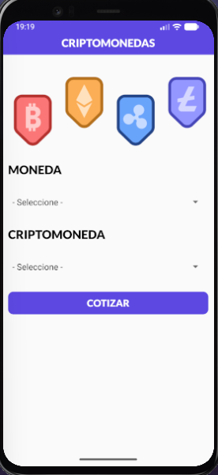
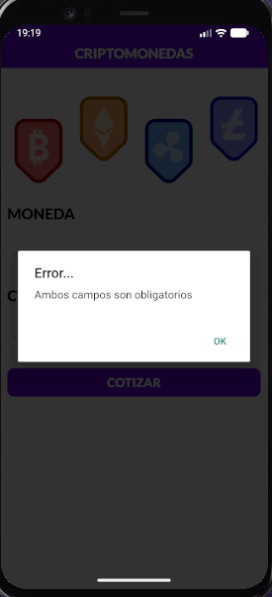
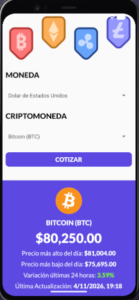

# 💰 Criptomonedas — React Native

Aplicación construida con **React Native 0.87.1** para consultar cotizaciones de criptomonedas en distintas monedas fiduciarias. Incluye un formulario con pickers personalizados, imagen principal y fuentes locales vinculadas a los proyectos nativos de Android e iOS.

> Proyecto generado con [`@react-native-community/cli`](https://github.com/react-native-community/cli).

---

## 📋 Requisitos

- **Node.js** >= 22.11.0
- **Android SDK** (API 24+, compileSdk 37)
- **Android Emulator** o dispositivo físico conectado
- **Java JDK** 17+
- **Git Bash** o PowerShell (Windows)

> **Nota sobre iOS:** el proyecto incluye la carpeta `ios/` generada por React Native CLI, pero las instrucciones de este README están orientadas a Android. Para compilar en iOS se requiere macOS con Xcode.

---

## 🚀 Cómo levantar el proyecto

### Opción 1: Script automático (Recomendado)

Ejecutá el script que hace todo automáticamente:

```powershell
npm run android:full
```

Este script:
- Cierra Metro anterior si está corriendo en el puerto 8081
- Inicia el emulador si no está abierto
- Cierra y limpia la caché de la app anterior
- Inicia Metro bundler en una ventana separada
- Compila e instala la APK
- Reinicia la app para una conexión limpia

### Opción 2: Manual por pasos

**Paso 1 — Instalar dependencias:**

```bash
npm install
```

**Paso 2 — Vincular fuentes nativas:**

```bash
npx react-native-asset
```

**Paso 3 — Metro bundler:**

```bash
npx react-native start
```

**Paso 4 — Compilar e instalar:**

En otra terminal:

```bash
cd android
./gradlew clean
./gradlew :app:assembleDebug
cd ..
adb install -r android/app/build/outputs/apk/debug/app-debug.apk
adb shell am start -n com.criptomonedas/.MainActivity
```

---

## 🧪 Tests y calidad de código

| Comando | Propósito |
|---------|-----------|
| `npm test` | Ejecuta la suite de Jest |
| `npm run lint` | Ejecuta ESLint sobre todo el proyecto |
| `npx tsc --noEmit` | Verifica tipos de TypeScript sin emitir archivos |

---

## ✨ Funcionalidades

- **Header personalizado**: título con fuente local `Lato-Black` y estilos propios.
- **Imagen principal**: imagen de criptomonedas renderizada en `App.tsx`.
- **Formulario de consulta**: pickers para seleccionar moneda fiduciaria y criptomoneda.
  - Carga las 10 criptomonedas con mayor capitalización desde CoinGecko.
  - Validación nativa si faltan campos.
- **Cotización en tiempo real**: consulta CoinGecko (`/coins/markets`) y muestra precio actual, precios alto/bajo del día, variación 24h y última actualización.
- **Soporte de monedas**: USD, MXN, EUR, GBP y **PYG (Guaraní Paraguayo)**.
  - CoinGecko no soporta PYG, por lo que se consulta en USD y se convierte con la tasa del día vía `open.er-api.com`.
- **Formato de moneda**: helper `formatearCantidad` que formatea los valores con símbolo según la moneda seleccionada.
- **Fuentes locales**: familia `Lato` vinculada en Android e iOS vía `react-native-asset`.
- **Estructura modular**: componentes organizados bajo `src/components/` y helpers bajo `src/helpers/`.

---

## 📸 Vistas de la app

| Pantalla principal | Formulario de consulta | Resultado de cotización |
|---|---|---|
|  |  |  |

---

## 🪵 Cómo ver los logs (console.log / console.warn)

En React Native 0.87 con Hermes, los `console.log` a veces no aparecen en la terminal de Metro. Usá este comando para verlos en tiempo real:

```bash
adb logcat -s ReactNativeJS:D
```

**Filtrar solo tu app:**

```bash
adb logcat -s ReactNativeJS:D *:S
```

**Ver todo el log del sistema (útil para errores nativos):**

```bash
adb logcat
```

**Limpiar y empezar desde cero:**

```bash
adb logcat -c
adb logcat -s ReactNativeJS:D
```

---

## ⌨️ Comandos útiles de Metro

Una vez que Metro esté corriendo, presioná:

| Tecla | Acción |
|-------|--------|
| `r` | Recargar app(s) |
| `d` | Abrir Dev Menu |
| `j` | Abrir DevTools (React Native DevTools) |
| `Ctrl + C` | Cerrar Metro |

---

## 📁 Estructura del proyecto

```
react-native-criptomonedas/
├── android/              # Proyecto Android nativo
├── ios/                  # Proyecto iOS nativo (requiere macOS + Xcode)
├── assets/               # Recursos locales
│   ├── fonts/            # Fuentes Lato
│   └── img/              # Imágenes de la app
├── src/                  # Código fuente organizado
│   ├── components/       # Componentes reutilizables (Header, Formulario, Cotizacion)
│   ├── helpers/          # Funciones utilitarias
│   ├── styles/           # Estilos globales
│   └── types/            # Tipos compartidos de TypeScript
├── App.tsx               # Pantalla principal
├── index.js              # Punto de entrada de la app
├── start.ps1             # Script automático de inicio en Windows
├── react-native.config.js # Configuración de assets para react-native-asset
├── package.json
├── package-lock.json
├── metro.config.js
├── babel.config.js
├── tsconfig.json
├── jest.config.js
├── jest.setup.js
├── .eslintrc.js
├── .prettierrc.js
└── README.md
```

---

## 📦 Dependencias principales

| Paquete | Versión | Uso |
|---------|---------|-----|
| `react-native` | 0.87.1 | Framework principal |
| `react` | 19.2.3 | Librería React |
| `react-native-safe-area-context` | ^5.5.2 | SafeAreaView y contexto de área segura |
| `@react-native-picker/picker` | ^2.11.4 | Pickers nativos para moneda y criptomoneda |

---

## 📦 Build de release (APK)

Para generar una APK de release, usá el script ya configurado en `package.json`:

```bash
npm run build:apk
```

Este comando compila la APK de release y la copia directamente a la raíz como `app-criptomonedas.apk`.

Si preferís hacerlo paso a paso manual:

```bash
npm install
cd android && ./gradlew assembleRelease
```

La APK de release se generará en:

```
android/app/build/outputs/apk/release/app-release.apk
```

---

## 🛠️ Solución de problemas

### Pantalla en negro / App no carga

```bash
adb shell am force-stop com.criptomonedas
adb shell pm clear com.criptomonedas
adb install -r android/app/build/outputs/apk/debug/app-debug.apk
adb shell am start -n com.criptomonedas/.MainActivity
```

### Emulador no se detecta

```bash
adb devices
```

Si no aparece, iniciá el emulador manualmente:

```bash
emulator -avd Pixel_4
```

### Error "Metro ya está corriendo"

Matá el proceso anterior:

```bash
netstat -ano | findstr 8081
taskkill /F /PID <PID>
```

### Error "RNCAndroidDialogPicker" no encontrado

El picker nativo no está compilado en la APK. Ejecutá:

```bash
cd android
./gradlew clean
cd ..
npx react-native run-android
```

---

## 🧹 Limpieza de archivos generados

Si el proyecto ocupa varios GB, es por archivos generados durante la compilación. El `.gitignore` ya evita que entren en git, pero los archivos siguen ocupando espacio en disco de forma local.

Estas carpetas se pueden borrar de forma segura:

```bash
rm -rf android/app/build
rm -rf android/app/.cxx
rm -rf android/.gradle
rm -rf android/build
rm -rf node_modules
```

O podés usar el script ya configurado en `package.json`:

```bash
npm run clean:deps
```

### Regenerar el proyecto después de limpiar

```bash
npm install
npm run build:apk
```

---

## 👨‍💻 Autor

- **Yamil Zaracho**
